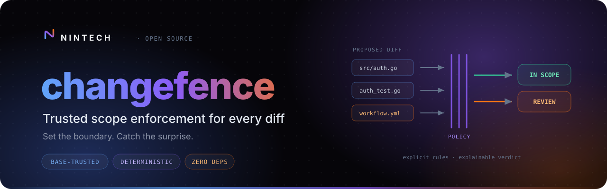
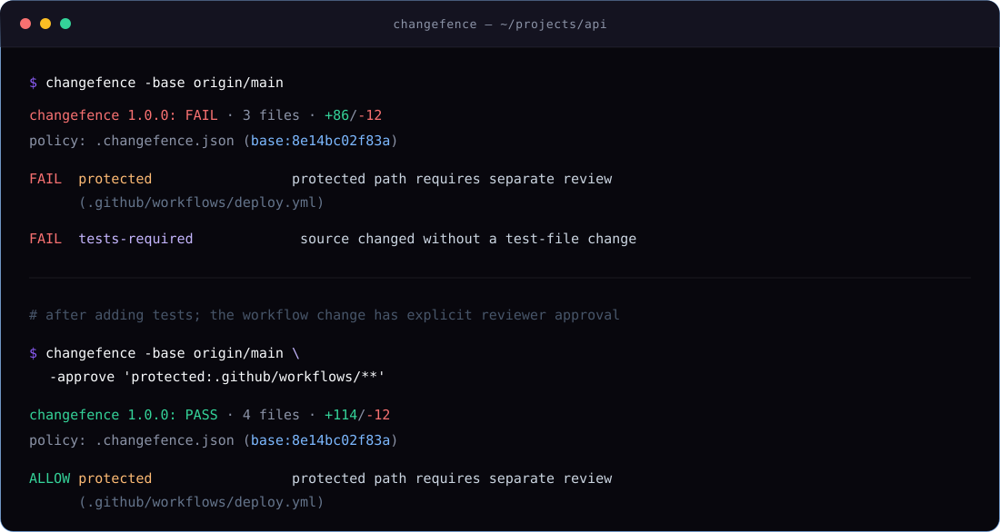
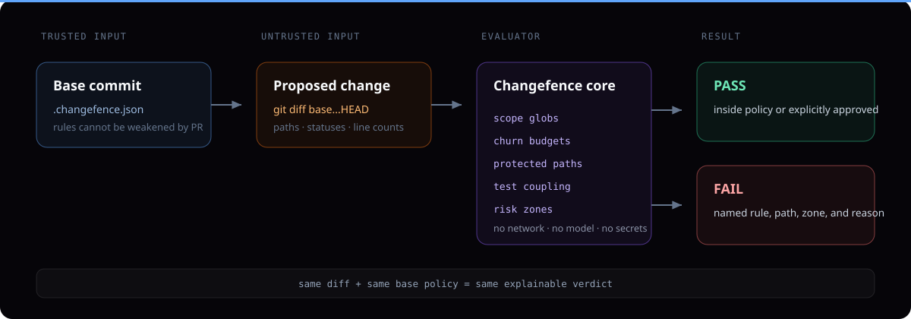

<p align="center">
  
</p>

<p align="center">
  <a href="https://github.com/nintechio/changefence/actions/workflows/ci.yml"></a>
  <a href="https://github.com/nintechio/changefence/releases"></a>
  <a href="https://pkg.go.dev/github.com/nintechio/changefence"></a>
  <a href="LICENSE"></a>
</p>

<p align="center">
  <a href="#quick-start">Quick start</a> ·
  <a href="docs/policy.md">Policy reference</a> ·
  <a href="docs/recipes.md">Recipes</a> ·
  <a href="docs/security-model.md">Security model</a> ·
  <a href="CONTRIBUTING.md">Contributing</a>
</p>

Changefence is a small, deterministic gate that answers a question tests and linters do not:

> Did this change stay inside the boundary we agreed to?

It evaluates a Git diff against explicit limits for paths, file count, line churn, dependency manifests, binary files, test coupling, and high-risk zones. Its own code uses no model or network client, sends no telemetry, and has no third-party Go dependencies.

That makes it useful for pull requests created by people, scripts, dependency bots, and coding agents—anywhere a correct-looking change can still be unexpectedly broad.

<p align="center">
  
</p>

## Quick start

Add a policy:

```bash
cp .changefence.example.json .changefence.json
```

Then add the GitHub Action. A full checkout is required so Git can calculate the merge-base diff:

```yaml
name: Changefence
on: [pull_request]

permissions:
  contents: read

jobs:
  scope:
    runs-on: ubuntu-latest
    steps:
      - uses: actions/checkout@v6
        with:
          fetch-depth: 0
      - uses: nintechio/changefence@v1
```

For pull-request events, the action takes the base commit directly from GitHub's event payload and reads `.changefence.json` from that commit. A proposed change cannot point the check at its own weakened policy.

The first setup pull request is evaluated with conservative built-in defaults because the policy does not exist on the base branch yet. Review and merge that bootstrap change before making Changefence a required check. See [installation and rollout](docs/installation.md).

## A practical policy

```json
{
  "$schema": "https://raw.githubusercontent.com/nintechio/changefence/main/policy.schema.json",
  "max_files": 12,
  "max_additions": 500,
  "max_deletions": 500,
  "max_lines_per_file": 300,
  "allowed": ["src/**", "tests/**", "docs/**"],
  "forbidden": ["infra/prod/**"],
  "protected": [
    ".changefence.json",
    ".github/workflows/**",
    "CODEOWNERS",
    "SECURITY.md"
  ],
  "source_patterns": ["src/**"],
  "test_patterns": ["tests/**", "**/*_test.*"],
  "require_tests_for_source": true,
  "allow_dependency_changes": false,
  "allow_binary_changes": false,
  "zones": [
    {
      "name": "database-migrations",
      "patterns": ["db/migrations/**"],
      "max_files": 2,
      "max_additions": 200,
      "protected": true
    }
  ]
}
```

Omitted fields keep their built-in defaults. A numeric limit of `0` disables that limit. Unknown fields, invalid globs, negative limits, duplicate zone names, and trailing JSON all fail closed.

## Why the base policy matters

<p align="center">
  
</p>

Many policy checks load configuration from the checked-out pull-request branch. That lets the same change relax the rule it is about to violate. Changefence instead resolves the base commit first and reads policy with Git object access. The proposed worktree is used only as diff input.

## Install the CLI

With Go 1.22 or newer:

```bash
go install github.com/nintechio/changefence@latest
changefence -base origin/main
```

Or download a release archive and verify its checksum and provenance. See [installation](docs/installation.md).

Useful output modes:

```bash
changefence -base origin/main -format text
changefence -base origin/main -format json
changefence -base origin/main -format markdown
changefence -base origin/main -format github
```

Exit `0` means the diff is within policy. Exit `1` means one or more unapproved violations were found. Exit `2` means the repository, policy, event, or input could not be evaluated safely.

## Deliberate boundaries

Changefence does not decide whether code is correct, secure, or well designed. It does not infer intent, assign risk with a model, or replace tests and review. It enforces the explicit scope contract before reviewers spend attention on correctness.

Protected-path approvals are available in the CLI for trusted orchestration, but intentionally are not exposed by the pull-request Action. A PR-controlled workflow is not a trustworthy place to grant its own exception. The [security model](docs/security-model.md) explains safe exception patterns and remaining platform assumptions.

## Documentation

- [Installation and rollout](docs/installation.md)
- [Complete policy and rule reference](docs/policy.md)
- [Monorepo, migration, infrastructure, and documentation recipes](docs/recipes.md)
- [Output formats and automation](docs/output.md)
- [Threat model and trust boundaries](docs/security-model.md)

## Community

Focused bug reports, policy recipes, and pull requests are welcome. Please read [CONTRIBUTING.md](CONTRIBUTING.md), the [community guidelines](CODE_OF_CONDUCT.md), and [SECURITY.md](SECURITY.md) before reporting sensitive issues.

MIT © [Nintech Ltd](https://nintech.io)
